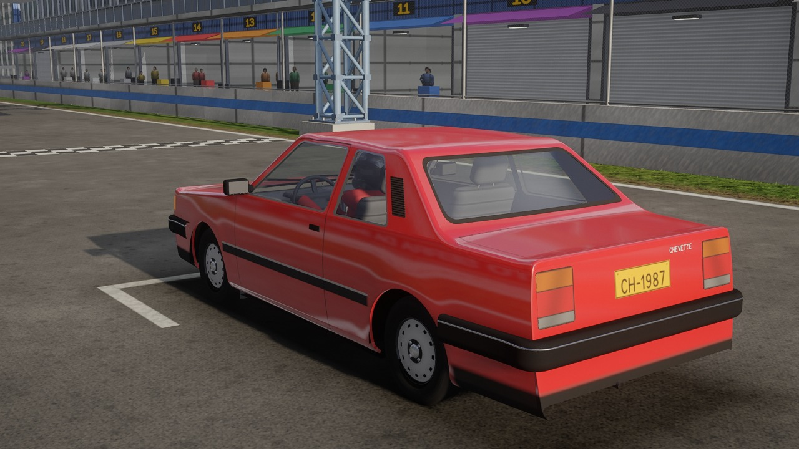
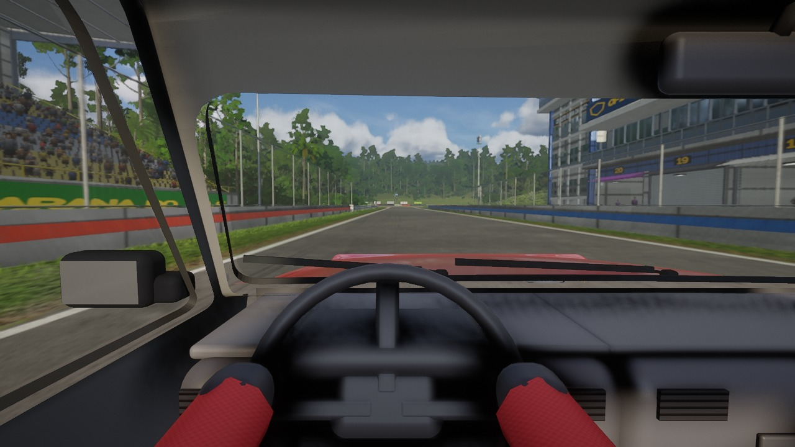
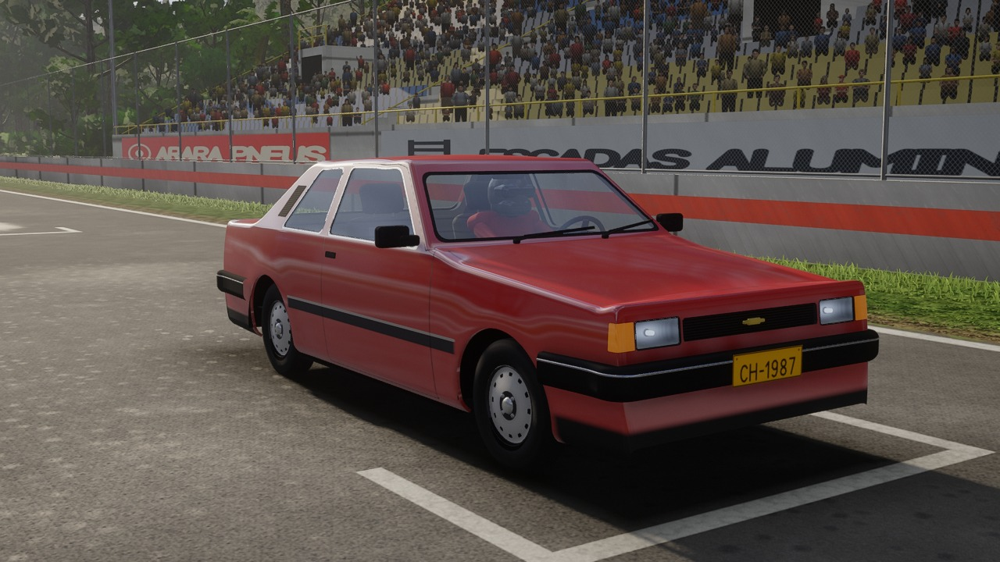
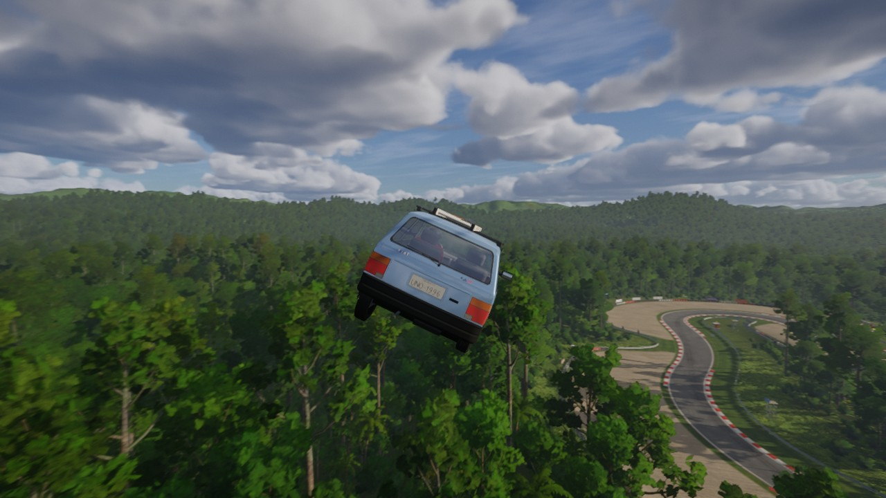
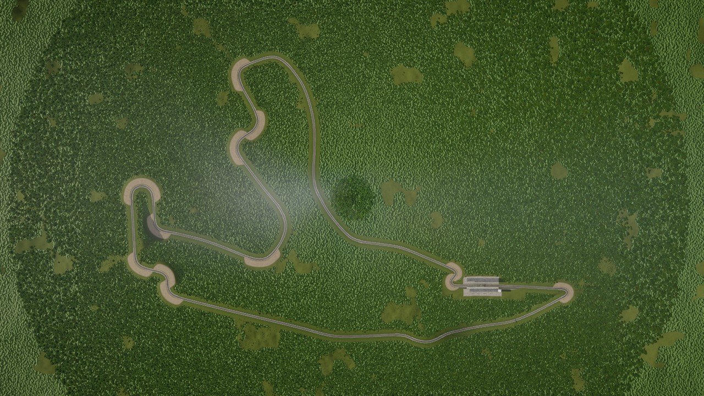

# Uno com escada

**Um Fiat Uno Mille EP 1996, com uma escada de alumínio no teto, para pilotar num circuito de corrida, direto no navegador.**

São duas versões do mesmo jogo, feitas por dois modelos de IA a partir do mesmo pedido: uma pelo Claude Fable 5.2 e outra pelo Claude Opus 5.5. Cada versão é um único `index.html`. Carro, pista, mata, céu e som saem do código: nenhuma delas usa textura, modelo 3D, áudio gravado, engine ou biblioteca 3D.


O projeto nasceu num vídeo do canal [ViktorKav](https://www.youtube.com/@vkav) sobre como escrever um pedido para a IA. O material de apoio do vídeo está em [viktorkav.com.br/apoio/uno-com-escada](https://viktorkav.com.br/apoio/uno-com-escada/).

## O que este fork acrescenta

Este repositório é um fork de [viktorkav/uno-com-escada](https://github.com/viktorkav/uno-com-escada). Tudo abaixo foi acrescentado à **versão do Fable** (`fable/`); a versão do Opus está como no original. Para jogar com as mudanças: **[murilogoedert.github.io/cacete-corca](https://murilogoedert.github.io/cacete-corca/)**.

| Chevette SL 1987 | Câmera do piloto |
|---|---|
|  |  |
|  |  |



1. **Segundo carro: Chevrolet Chevette SL 1987**, vermelho, modelado sobre a mesma pele paramétrica do Uno: três volumes, para-choques pretos com filete, friso lateral, lanternas de três faixas, grade de ventilação na coluna C, rodas de aço, placa amarela. A tecla `Y` (controle: `LB`) troca de carro no lugar, com o carro andando.
2. **Tração traseira** no Chevette: o torque vai para as rodas de trás, que patinam e perdem aderência lateral na aceleração. Cerca de 11% mais torque que o Uno, 4 marchas, mais peso atrás.
3. **Tração dosada em curva**, ajustável com o jogo rodando: `↑` e `↓` mudam quanto da aderência traseira o motor pode usar em curva (o valor aparece na tela). As setas `↑` `↓` deixaram de acelerar e frear; isso fica em `W` e `S`.
4. **Distribuição de freio pela carga**: no Chevette cada roda freia na proporção do peso que tem naquele instante, e a traseira não trava na entrada da curva.
5. **Carro voador** (`Backspace`), à moda do GTA San Andreas: acima de ~36 km/h, `↓` tira o carro do chão; no ar `↓` sobe, `↑` desce e `A`/`D` viram inclinando.
6. **Segundo mapa: Spa-Francorchamps em tamanho real** (7 km), com o traçado tirado do mapa oficial e o relevo do mapa de elevação (470 m em Les Combes, 373 m em Paul Frère). A tecla `P` troca de mapa recarregando a página. Guard-rails, zebras, brita, boxes, arquibancada e mata são os do jogo original.
7. **Limites de pista**: a volta é invalidada quando as quatro rodas saem da pista ou quando alguma roda pega a brita. O tempo fica vermelho e a volta não vale como melhor volta. Zebra vale.
8. **Minimapa** no canto inferior esquerdo, com o traçado e a posição do carro.
9. **Câmera do piloto**: a tecla `C` passa também por uma câmera atrás do volante.
10. **Melhor volta guardada por carro e por mapa.**
11. `AGENTS.md` com o que foi aprendido ao fazer as mudanças, e `fable/tools/` com os scripts de verificação e de geração do traçado de Spa.

O que não mudou: a física do Uno. A volta roteirizada e o benchmark terminam exatamente no mesmo estado do jogo original, e usam sempre o Uno no circuito Serra da Mata.

## Jogar

Pelo navegador, sem baixar nada:

- [Versão do Fable 5.2](https://viktorkav.com.br/apoio/uno-com-escada/fable/)
- [Versão do Opus 5.5](https://viktorkav.com.br/apoio/uno-com-escada/opus/)

Ou no seu computador:

1. Baixe [`fable/index.html`](fable/index.html) ou [`opus/index.html`](opus/index.html).
2. Abra o arquivo no **Chrome** ou no **Edge**, num computador.
3. Espere alguns segundos enquanto o circuito é montado e aperte **Começar**.

Não há nada para instalar, e a página funciona sem rede. Ela precisa de um navegador com **WebGPU**. O alvo do pedido foi um MacBook Pro M4 Max em 2560×1440; em máquina mais modesta, a taxa de quadros cai.

## As duas versões

| | Fable 5.2 | Opus 5.5 |
|---|---|---|
| Nome do jogo | Uno com escada | Mille EP |
| Circuito | Serra da Mata | Circuito da Serra |
| Tempo de trabalho | 7 h 12 min | 5 h |
| Rodadas do crítico visual | 8 | 11 |
| Defeitos graves na última rodada | 4 | 5 |
| Preço de API | US$ 347,64 | US$ 87,81 |
| Tamanho na entrega do teste | 546 KB | 338 KB |
| Tamanho com som e menu | 603 KB | 341 KB |

| Fable 5.2 | Opus 5.5 |
|---|---|
|  |  |
|  |  |

Os dois modelos rodaram em esforço alto, cada um com o crítico visual dele, sem limite de rodadas nem de tempo. **Nenhum dos dois fechou o critério de pronto:** o pedido só dava a tarefa por pronta quando o crítico não apontasse mais nada acima de defeito menor, e os dois ainda tinham defeito grave na última rodada. O Opus encerrou por conta própria na rodada 11, avisando que a tarefa não estava pronta. O Fable foi interrompido na rodada 8.

## Controles

Os dois jogos respondem aos mesmos comandos. A lista também aparece na tela de início.

| | Teclado | Controle |
|---|---|---|
| Acelerar | `W` (e `↑` na versão do Opus) | Gatilho direito |
| Frear e dar ré | `S` (e `↓` na versão do Opus) | Gatilho esquerdo |
| Carro voador, versão do Fable: liga e desliga com `Backspace`; no ar, `↓` sobe e `↑` desce | `Backspace` `↑` `↓` | |
| Trocar de mapa, versão do Fable (recarrega a página): Serra da Mata ou Spa-Francorchamps em tamanho real | `P` | |
| Chevette, versão do Fable: tração em curva | `↑` `↓` | |
| Fazer curvas | `A` `D` ou `←` `→` | Analógico esquerdo |
| Freio de mão | `Espaço` | `A` |
| Trocar a câmera | `C` | `Y` |
| Trocar de carro (só na versão do Fable) | `Y` | `LB` |
| Olhar para trás | Segurar `V` | Segurar `RB` |
| Devolver o carro à pista | `R` | `X` |
| Pausar e abrir o menu | `Esc` | `Start` |

| Ferramenta | Tecla |
|---|---|
| Ligar e desligar o som | `M` |
| Estatísticas de desempenho | `H` |
| Benchmark: a volta roteirizada de 60 s, com média e máximo no fim | `B` |
| Assistir à volta roteirizada | `F` |
| Poses fixas de câmera | `1` a `6` |

Na versão do Fable há um segundo carro: um Chevrolet Chevette SL 1987 vermelho, de tração traseira e com um pouco mais de motor. A troca acontece no lugar, com o carro andando; a melhor volta é guardada por carro, e a volta roteirizada e o benchmark usam sempre o Uno.

Na versão do Fable a volta é invalidada (tempo em vermelho, não vale como melhor volta) quando as quatro rodas saem da pista ou quando alguma roda pega a brita; passar por cima da zebra vale.

O câmbio é automático, e a volta conta quando o carro cruza a linha de largada. O som começa depois do primeiro clique.

## Como foi feito

A pasta [`pedidos`](pedidos) tem o texto que a IA recebeu, sem cortes:

| Arquivo | O que é |
|---|---|
| [`01-circuito.txt`](pedidos/01-circuito.txt) | O pedido do jogo. Prioridades em ordem, restrições, máquina-alvo, cena, três verificações (crítico visual, desempenho e controles) e o critério de pronto. Foi o mesmo texto para o Fable 5.2 e para o Opus 5.5. |
| [`02-som-e-menu.txt`](pedidos/02-som-e-menu.txt) | O pedido seguinte: controle, painel, tela de início, menu, benchmark e som sintetizado. Foi passado ao Fable 5.2 nos dois jogos, depois do teste. |
| [`03-ajustes.txt`](pedidos/03-ajustes.txt) | Três ajustes finais de texto e de volume. |

O crítico visual do primeiro pedido é um subagente novo a cada rodada, que vê só as imagens do jogo e as referências, nunca o código. As fotos do carro e as capturas usadas como referência de imagem não fazem parte deste repositório.

O molde do pedido vem do [Abyssal Garden](https://github.com/Noniv/abyssal-garden), do Noniv: um oceano 3D de 97 KB, feito do mesmo jeito.

## Mexer no código

O código legível de cada versão está na pasta `source` dela. Para mudar alguma coisa e montar o `index.html` de novo, basta o [Node.js](https://nodejs.org) 18 ou mais novo, sem instalar pacote nenhum:

```bash
node fable/source/build.mjs
node opus/source/build.mjs
```

Cada comando reescreve o `index.html` da versão.

**Versão do Fable** ([`fable/source`](fable/source)): os arquivos de `js/` entram na página na ordem do nome.

| Arquivo | O que tem dentro |
|---|---|
| `js/10_track.js` | O circuito: traçado, elevação e zonas. **Um bom lugar para começar.** |
| `js/30_car_*.js` | O Uno: a forma da carroceria, a pintura, as peças, o rack e a escada |
| `js/30_car_e_extras.js` | Os carros extras (o Chevette), feitos sobre a mesma pele do Uno |
| `js/31_world.js`, `js/32_props.js` | Terreno, pista, guard-rails, arquibancada, boxes e pórtico |
| `js/33_veg_*.js` | A mata: árvores, grama e os impostores de longe |
| `js/40_vehicle.js` | A física do carro |
| `js/45_game.js` | Entrada, câmeras e a volta roteirizada |
| `js/50_som.js` | O som, sintetizado na hora |
| `js/51_painel.js`, `js/52_ui.js` | Painel, tela de início, menu e benchmark |
| `wgsl/` | Os shaders: materiais, céu, sombras, pós-processamento |

**Versão do Opus** ([`opus/source`](opus/source)):

| Arquivo | O que tem dentro |
|---|---|
| `js/track.js` | O circuito. **Um bom lugar para começar.** |
| `js/car_model.js`, `js/cargfx.js` | O Uno e as malhas dele na GPU |
| `js/world.js`, `js/terrain.js`, `js/vegetation.js` | Pista, terreno e mata |
| `js/physics.js` | A física do carro |
| `js/game.js` | Carga, laço principal, entrada e câmeras |
| `js/som.js` | O som, sintetizado na hora |
| `js/painel.js` | O painel do jogo |
| `js/renderer.js`, `shaders/` | O renderizador e os shaders |

## Licença

[PolyForm Noncommercial 1.0.0](LICENSE.md): livre para usar, estudar, mudar e compartilhar sem fim comercial.
